# reset-mining

<!-- status:start -->
## Live status
Updated **2026-10-28 21:12 UTC** (every 15 min)

| | |
|---|---|
| Balance | **0.01000000 RESET** |
| Locked (mining) | **0.00000000 RESET** |
| Progress to 0.1 minimum | 10% |
| Mine round | 650 (claim window open) |
| This round's claim | none |
| Strikes | 0 |
| Header posts won (logged) | 0 |
| Bitcoin tip | 973599 |

[Full activity log](state/activity.jsonl)
<!-- status:end -->

Unattended RESET Mine participation.
Experiment only. No token purchases, no transfers.

## How it works
- `.github/workflows/reset-worker.yml` is kicked every 15 min by a Cloudflare Worker (GitHub cron does not fire here) and on demand (Actions tab, Run workflow).
- It installs the official signer at the commit in `worker/RESET_COMMIT`, runs one pass of `worker/run.mjs`.
- A pass: status, post Bitcoin headers (every 10 min at most), lock up to `max_lock`, and once per round, while the claim window is open, asks an AI model (GitHub Models, free) for the claim level, clamped to `policy.json`.
- Never calls transfer, unlock or withdraw. One worker at a time (concurrency group). Uncertain moves are not resubmitted.
- Results: `state/activity.jsonl` (every action: accepted / uncertain / balance changes = applied & settled).

## Control
- Pause: set `"enabled": false` in `worker/policy.json` (or Actions → reset-worker → Disable workflow).
- Resume: `"enabled": true` / Enable workflow.
- Stop for good: disable the workflow, then exit the Mine (below).
- Limits: `max_lock` (coins it may lock; "0" = none), `allow_over` (overclaiming), `max_level`, `run_until` (ISO date).

## Leaving the Mine
`unlock {"amount":...}` starts a 144-counted-block wait (~1 day); then `withdraw` once pending claims settle. Exiting coins can still be penalized until withdrawn.
